<div align="center">



<sub>Computer Engineering student at INSA Toulouse · cybersecurity · networks · systems · machine learning</sub>

<br><br>


<br><br>

<!-- TODO: add your links once they exist, for example:
<a href="https://YOUR-PORTFOLIO-URL"></a>
-->

</div>



## ❖ The Entrance Hall

Hello, I'm **Adam**. I study Computer Science at **INSA Toulouse** (Master of Engineering, class of 2029) and I'm first in my cohort. I like understanding things all the way down: the packet on the wire, the byte in memory, the gradient in the network.

My name sent me looking for apples, and the Renaissance gave me the idea that one person can build across disciplines. So this profile is a museum. Take the tour.

```
   ╭────────╮                                        ╭────────╮
   │  ADAM  │  ─ ─ ─ ─ ─ ─ ─  🍎  ─ ─ ─ ─ ─ ─ ─      │  CODE  │
   ╰────────╯                                        ╰────────╯
                  the spark lives in the gap
```


## ❖ The Wings

> *Each project is a painting. Each one has a problem, a decision, and a result.*

| Wing | Work | What it is |
|---|---|---|
| 🜂 **Machine Learning** | **Neural-network framework in C** *(in progress)* | An ML/NN framework written from scratch in C: tensors, backprop, and memory management, no libraries |
| 🜄 **Systems & Networks** | **CloudBox** | FastAPI + PostgreSQL REST API for resumable uploads. Dockerized, 70 pytest unit tests, GitHub Actions CI |
| | **NetSentinel** | A network security monitor |
| | **Raspberry Cloud** | A self-hosted cloud running on Raspberry Pi hardware |
| 🜁 **Web** | **24H de Toulouse platform** | E-commerce and ticketing platform for a student event, built as Head Full Stack Developer |
| 🜃 **Aerospace** | **Astre Club flight software** | Flight software sub-system lead for a stratospheric balloon launch |

<!-- TODO: link each project name to its repo, e.g. **[CloudBox](https://github.com/kha-adam/REPO-NAME)** -->

## ❖ Special Exhibition: Hackathons

*Limited runs. Built under pressure.*

| Exhibit | Challenge | Outcome |
|---|---|---|
| Hackathon I | <!-- TODO --> | <!-- TODO --> |
| Hackathon II | <!-- TODO --> | <!-- TODO --> |


## ❖ The Workshop

<div align="center">


</div>

## ❖ The Journey

```
 Jul 2025 ───── Pole Star ·················· Software Engineering Intern
    │
 2025+ ──────── 24H de Toulouse ············ Head Full Stack Developer
    │
 2025+ ──────── International Students Office  Head of Travels division
    │
 Oct 2026 ───── Astre Club ················· Flight Software Sub-System Leader
    │
 Jan–May 2027 ─ The University of Hong Kong · exchange semester   ◀ next
```

<!-- TODO: adjust the 24H and International Students Office date ranges -->

## ❖ Currently on the Easel

-  Writing a **neural-network framework in C**, from scratch
-  Building the **flight software** for a stratospheric balloon
-  Preparing my semester at **HKU** (and my Russian)

## ❖ Languages I Speak

`Français` · `English` · `العربية` · `Deutsch (B2)` · `Español (B1)` · `Русский (A2)`


## ❖ The Orchard

*My contribution graph, eaten by a snake. Regenerated daily by a GitHub Action.*

<div align="center">
<picture>
  <source media="(prefers-color-scheme: dark)"  srcset="https://raw.githubusercontent.com/kha-adam/kha-adam/output/snake-dark.svg">
  <source media="(prefers-color-scheme: light)" srcset="https://raw.githubusercontent.com/kha-adam/kha-adam/output/snake-light.svg">
  
</picture>
</div>

<div align="center">

<br>

```
        ·  ·  ·  ·  ·  ·  ·  ·  ·  ·  ·
          Knowledge, compiled.   🍎
        ·  ·  ·  ·  ·  ·  ·  ·  ·  ·  ·
```

<!-- TODO: email · LinkedIn · portfolio URL -->

</div>
