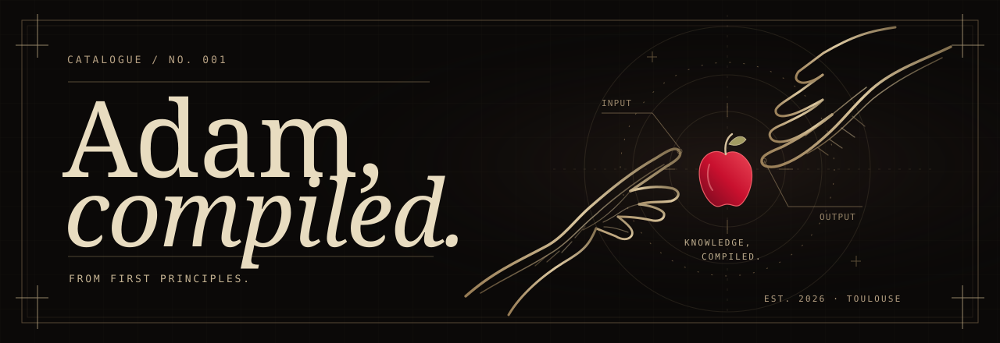

  

   

  <strong>Software engineering student at INSA Toulouse · Systems, networks &amp; security</strong>

  I build things from first principles. Preferably the parts you don't see.

    

  <!-- <a href="YOUR_PORTFOLIO_URL">Enter the museum</a> &nbsp;·&nbsp; -->
  <a href="https://github.com/kha-adam?tab=repositories">Source code</a> &nbsp;·&nbsp;
  <a href="./assets/Adam_Khalloufi_resume">Résumé</a> &nbsp;·&nbsp;
  <a href="mailto:adam.officiel.96@gmail.com">Contact</a>

---

### The curator's note

I'm **Adam Khalloufi**, studying Computer Engineering at **INSA Toulouse**. I like understanding what happens beneath the abstraction: packets crossing a network, requests finding their way through an API, software meeting the constraints of real machines.

This profile is a small collection of things I've built, broken, understood, and built again.

### Selected works  / the permanent collection

**`01 / SYSTEMS` · [CloudBox](https://github.com/kha-adam/cloudbox)**  
*File storage, with ownership and reliability designed in.*  
A FastAPI and PostgreSQL service for authenticated uploads, downloads, listing and deletion. Per-user authorization, SHA-256 checksums, isolated tests, Docker Compose and CI.  
`Python` `FastAPI` `PostgreSQL` `Docker` `pytest`

**`02 / NETWORKS` · [NetSentinel](https://github.com/kha-adam/netsentinel)**  
*Listening to the network, not just trusting it.*  
A Scapy-based monitor that follows TCP connection behavior and flags patterns such as port scanning and SYN floods. Built to understand the protocols, not just display them.  
`Python` `Scapy` `TCP/IP` `Packet Analysis`

**`03 / THE REAL WORLD` · 24H de Toulouse platform**  
*An event platform where shipping meant people actually using it.*  
Maintained the event website and built a merchandise storefront, order flows and an admin dashboard. The shop processed roughly **90 orders**, alongside an event serving roughly **1,800 ticket holders**.  
`PHP` `MariaDB` `Docker` `Web Infrastructure`

**`04 / IN THE WORKSHOP` · Neural networks, from C [Machine Learning](https://github.com/kha-adam/ml-nn)**  
*A study of machine learning by rebuilding its foundations.*  
An in-progress neural-network framework in C. The goal: understand how the machinery works beneath high-level libraries, one implementation decision at a time.  
`C` `Linear Algebra` `Machine Learning` **`IN PROGRESS`**

---

### The workshop  / tools of the trade

**Build** `Python` `C` `FastAPI` `SQL` `Bash`  
**Operate** `Linux` `Docker` `GitHub Actions` `PostgreSQL`  
**Investigate** `TCP/IP` `Scapy` `tcpdump`

<b>Behind the frame: what I care about when I build</b>

 

- **Understand the mechanism.** Trace the packet, read the error, follow the data.
- **Make decisions explicit.** Document trade-offs instead of hiding them behind a library.
- **Prove it works.** Tests, reproducible environments, observable behavior.
- **Keep learning in public.** Even unfinished work can reveal a useful engineering question.

---

  THE COLLECTION IS NEVER FINISHED.
   
  <!-- <a href="YOUR_PORTFOLIO_URL">Explore the full museum</a> · -->
  <a href="https://www.linkedin.com/in/khalloufi-adam">LinkedIn</a> ·
  <a href="mailto:adam.officiel.96@gmail.com">Say hello</a>

